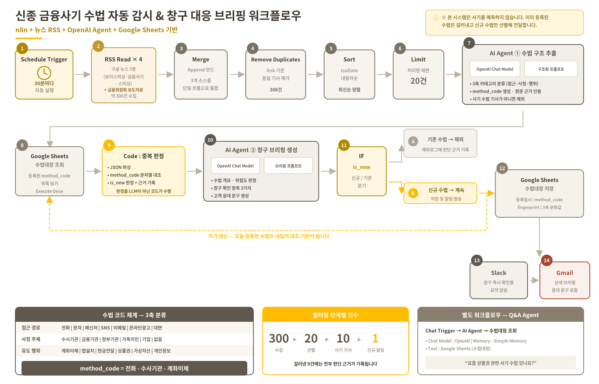
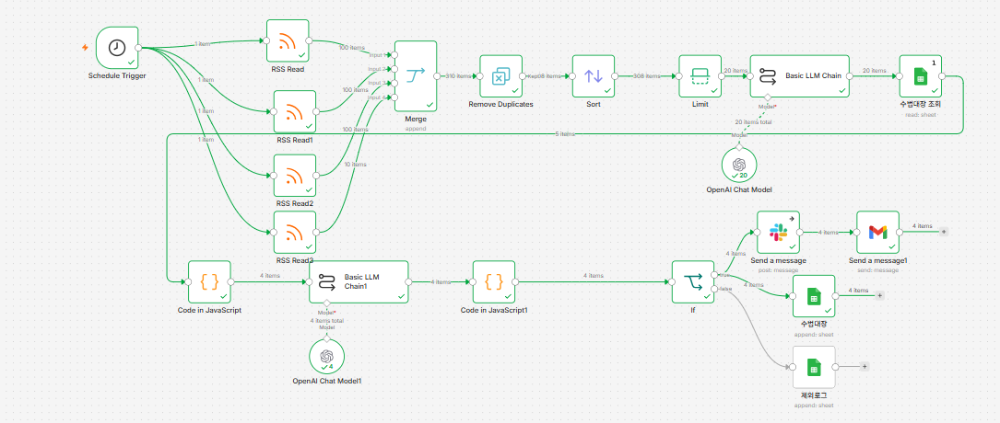
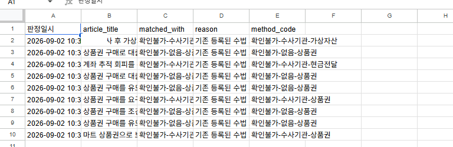
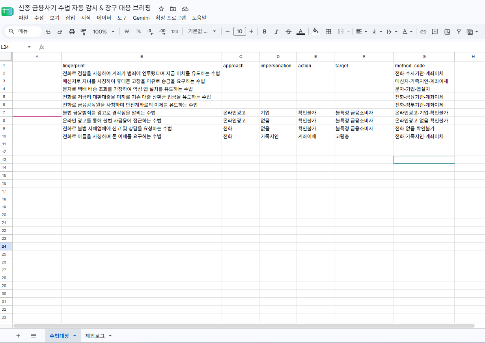
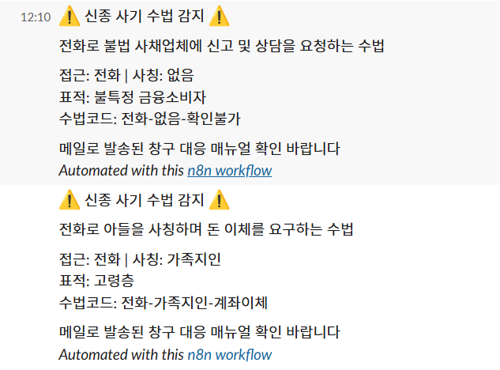
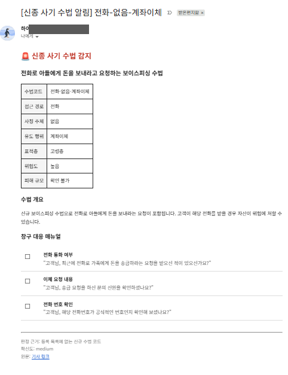

# 신종 금융사기 수법 자동 감시 — "많이 알리지 않는" 알림 자동화

> 뉴스·보도자료 약 300건을 30분마다 수집해, **이미 알려진 수법은 걸러내고 새 수법 1건만** 현장(창구)에 알리는 n8n 자동화 시스템입니다.
> 알림 피로를 줄이는 필터링 설계와, 걸러낸 이유를 전부 기록하는 추적성이 핵심입니다.

| 항목 | 내용 |
|---|---|
| 형태 | KB Bridge 부트캠프 n8n 미니프로젝트 · 6인 팀 (프로젝트명 "신세계") |
| 사용 기술 | n8n · OpenAI API (gpt-4o-mini) · Google Sheets · Slack API · Gmail · JavaScript (Code 노드) |
| 산출물 | 워크플로우 2종 (자동 감시 17노드 / Q&A Agent 5노드), 테스트 케이스 18건, 기획서·보고서 |
| 핵심 결과 | 수집 300건 → 알림 1건, 테스트 18건 전건 Pass |

**내 역할** : 서브 개발 — 워크플로우 구현 보조, API 연동 테스트, **수집 데이터 정제**(중복 기사 제거·최신순 정렬·처리량 제한) 참여, **Google Sheets 구조(수법대장·제외로그) 설계 및 데이터 검증**



---

## 01. 프로젝트 배경

새로운 사기 수법이 보도되면 담당자가 기사를 읽고, 정리하고, 공문을 만들어 지점에 배포하기까지 **수 일**이 걸립니다.
그 사이 창구 직원은 새 수법을 모른 채 이체를 처리하게 됩니다. 이 "정보 전달 구간"을 자동화 대상으로 잡았습니다.

- 이 시스템은 사기를 **예측**하지 않습니다. 이미 공개된 정보를 현장이 바로 쓸 수 있는 형태로 **전달**하는 시스템입니다.

## 02. 업무 문제

| 문제 | 내용 |
|---|---|
| 정보 분산 | 금감원·경찰청·언론에 정보가 흩어져 있음 |
| 전달 지연 | 기사 → 정리 → 공문 → 배포까지 수 일 |
| 정보 과잉 | 하루 수십 건 보도 중 대부분이 이미 알려진 수법의 반복 |
| 실행 불가 | 기사는 사건을 설명할 뿐, 창구에서 무엇을 확인할지 알려주지 않음 |
| **알림 피로** | 모든 기사를 알리면 며칠 만에 알림을 무시하게 됨 |

**목표:** 보도 후 30분 이내에, 새 수법만, 창구 확인 항목과 함께 전달

## 03. 데이터 설명

| 소스 | 방식 | 비고 |
|---|---|---|
| 구글 뉴스 RSS × 3 | 보이스피싱 / 금융사기 / 스미싱 키워드 | 요약이 짧아 정보 부족 건 발생 |
| 금융위원회 보도자료 RSS | 공식 발표 | 상대적으로 구체적 |

저장소 (Google Sheets)

| 시트 | 역할 | 주요 컬럼 |
|---|---|---|
| **수법대장** | 등록된 수법 목록 = 신규 판정 기준 | 등록일시, `method_code`, 접근경로, 사칭주체, 유도행위, 요약 |
| **제외로그** | 걸러낸 기사와 판단 근거 | 판정일시, 기사 제목, `matched_with`, `reason`, `method_code` |

## 04. 데이터 전처리

| 단계 (n8n 노드) | 처리 | 없으면 생기는 문제 |
|---|---|---|
| Merge (Append) | RSS 4개를 하나의 흐름으로 | 같은 처리를 4번 반복 |
| Remove Duplicates | `link` 기준 동일 기사 제거 | LLM 중복 호출 |
| Sort | `isoDate` 내림차순 | Limit이 최신이 아닌 임의 기사를 자름 |
| Limit | 20건으로 제한 | 비용·시간 급증 |
| LLM ① | 기사 → 수법 구조(JSON) 추출, 사기 수법 기사가 아니면 제외 | 자연어라 기계적 대조 불가 |

- 정렬 기준을 `pubDate`가 아닌 `isoDate`로 잡은 이유: `pubDate`는 `Mon, 24 Aug 2026 ...` 형식이라 문자열 정렬이 시간순과 맞지 않습니다.

## 05. 판정 기준 설계 — 수법 코드 체계

기사 URL로 중복을 제거해도, 같은 수법이 매체마다 다른 기사로 나오면 전부 "신규"로 통과합니다. **기사가 아니라 수법 기준으로 중복을 판정**해야 했습니다.

**1차 시도 (실패):** LLM이 쓴 자연어 요약끼리 비교 → 같은 수법도 매번 다른 문장이 나와 판정이 흔들림

**2차 시도 (해결):** LLM이 미리 정한 값 중에서만 고르게 하는 3축 코드

| 축 | 허용 값 |
|---|---|
| 접근 경로 | 전화, 문자, 메신저, SNS, 이메일, 온라인광고, 대면, 확인불가 |
| 사칭 주체 | 수사기관, 금융기관, 정부기관, 가족지인, 기업, 투자전문가, 없음, 확인불가 |
| 유도 행위 | 계좌이체, 앱설치, 현금전달, 상품권, 가상자산, 개인정보, 대출실행, 확인불가 |

```
method_code = 접근경로-사칭주체-유도행위
예) 전화-수사기관-계좌이체 (검찰 사칭 보이스피싱)
    문자-기업-앱설치       (택배 사칭 스미싱)
```

→ 중복 판정이 **문자열 비교**로 단순해져 같은 입력에는 항상 같은 결과가 나옵니다.

## 06. 워크플로우 로직 (JavaScript · LLM)



판정은 LLM이 아니라 **Code 노드**가 합니다.

```javascript
const known = new Set(
  $('수법대장 조회').all()
    .map(i => (i.json['method_code'] || '').trim())
    .filter(v => v)
);
const code = r.method_code.trim();
results.push({ json: {
  ...r,
  is_new: !known.has(code),
  matched_with: known.has(code) ? code : '',
  reason: known.has(code) ? '기존 등록된 수법 코드와 일치' : '등록 목록에 없는 신규 수법 코드'
}});
```

- **자기 갱신:** 신규 판정 수법은 알림과 동시에 수법대장에 자동 등록 → 다음 실행부터 대조 기준에 포함
- **LLM ② 제약:** "직원이 실제로 묻거나 눈으로 확인할 수 있는 것만", "고객을 의심하는 표현 금지"
- **프롬프트 인젝션 방어:** 기사 속 명령문은 분석 대상일 뿐 따르지 않도록 시스템 메시지에 명시
- **확신도:** 3축이 모두 원문에 있으면 high, 1개 확인불가면 medium, 그 이상이면 low → 담당자 원문 확인 유도

| 제약 없을 때 | 제약 적용 후 |
|---|---|
| 의심 거래에 주의한다 | 휴대폰에 최근 설치한 앱이 있는지 |
| 고객에게 확인을 안내한다 | 자녀에게 직접 전화해 확인했는지 |

**Q&A Agent (별도 워크플로우):** Chat Trigger → AI Agent(gpt-4o-mini + Memory + Sheets Tool). 수법대장에 없는 내용은 "없다"고 답하고, 답변 끝에 근거 `method_code`를 붙이도록 제약했습니다.

## 07. 시각화 · 실행 결과

**필터링 단계별 건수**

```
RSS 수집 ~300  →  최신순 선별 20  →  사기 수법 기사 10  →  신규 알림 1
                                                     (9건은 기존 코드와 일치 → 제외로그)
```

| 제외로그 — 9건 모두 판단 근거 기록 | 수법대장 — 자동 누적 |
|---|---|
|  |  |

| Slack — 즉시 확인용 요약 | Gmail — 확인 항목·응대 문구 상세 브리핑 |
|---|---|
|  |  |

**테스트:** 5개 시나리오 · 18개 케이스 · 18 Pass / 0 Fail → [`docs/테스트시나리오`](docs/)
신규 판정(True 분기)과 기존 제외(False 분기)를 **별도 케이스**로 나눠, 필터가 양방향 모두 정상 동작하는지 확인했습니다.

## 08. 주요 인사이트

1. **자동화가 아끼는 건 시간보다 주의력이다.** 30분마다 20건씩 알리면 반나절 만에 아무도 안 봅니다. 300건을 모아 1건만 알리는 구조가 핵심이었습니다.
2. **LLM이 할 일과 코드가 할 일은 다르다.** LLM은 비정형 텍스트를 구조화하고, 판정·대조는 코드가 해야 결과가 안정됩니다.
3. **걸러낸 기록이 걸러낸 행위보다 중요하다.** If의 False 분기를 연결하지 않으면 데이터가 조용히 사라집니다. 제외로그 덕분에 "9건을 이 근거로 걸렀다"고 설명할 수 있습니다.
4. **시행착오 8건을 기록했다.** 예) Sheets 노드가 메인 흐름을 덮어써 모든 출력이 같은 수법으로 나온 문제 → 노드 배치 변경 + `$('Basic LLM Chain').all()`로 직접 참조 / 시트 헤더 뒤 공백 때문에 값이 비는 문제 / Slack 실패 시 Gmail까지 멈추는 문제 → On Error: Continue

## 09. 생산·제조 업무 활용 방안

이 시스템의 구조(수집 → 코드화 → 기존 이력과 대조 → 새 건만 알림 → 판단 근거 기록)는 제조 현장의 **설비 알람·품질 이슈 관리**와 같은 구조입니다.

| 이 프로젝트 | 생산·제조 현장 적용 |
|---|---|
| 알림 피로 방지 (300 → 1) | 설비 알람 홍수(alarm flood) 방지: 반복·기지(旣知) 알람은 이력에만 남기고 **새 유형만 담당자에게 호출** |
| 3축 `method_code` | 불량 코드 체계: **현상-부위-원인** 등 정해진 값만 선택하게 해 작업자마다 다르게 적는 불량 기록을 표준화 → 파레토 집계 가능 |
| 수법대장 자기 갱신 | 불량·고장 이력 DB. 새 유형이 등록되면 다음부터 자동 분류 (FMEA 항목 누적과 유사) |
| 제외로그 (판단 근거 기록) | 품질 이력 추적성: "왜 조치하지 않았는가"까지 남겨 감사·원인 분석 대응 |
| 창구 확인 항목 3가지 | 작업자용 체크리스트: "주의하라"가 아닌 **눈으로 확인할 수 있는 항목**으로 작성 |
| 분기별 테스트 18건 | 변경 후 검증: 정상 경로만이 아니라 예외 경로까지 확인 |
| Slack 실패 시 Gmail 계속 발송 | 한 채널이 죽어도 전체가 멈추지 않는 fail-safe 설계 |

**연결되는 경험:** 하수처리시설 운영 중 PLC 연동 설비의 알람을 확인하며, 반복 알람과 실제 조치가 필요한 알람을 구분하는 것이 현장 대응 속도를 좌우한다는 것을 체감했습니다. 이 프로젝트에서 그 구분을 규칙과 코드로 자동화해 봤습니다.

## 10. 한계 및 개선 방향

| 영역 | 한계 | 개선 방향 |
|---|---|---|
| 판정 정확도 | "아들을 사칭"과 "아들을 언급"이 다른 코드로 분류되는 사례 | 사칭 판단 규칙을 프롬프트에 명시, 유도 행위 없는 건 사전 제외 |
| 데이터 품질 | 뉴스 RSS 요약이 짧아 "확인불가" 비율이 높음 | 금감원·경찰청 보도자료 소스 추가 |
| 운영 안정성 | 실행 실패 자체는 알리지 않음 | 실패 감시용 워크플로우 추가 |
| 활용 | 현재는 신규 알림만 제공 | `method_code`별 주간 증가 추이 리포트 |
| 구조적 한계 | 보도 이후에 감지하므로 첫 피해는 막지 못함 | 범위를 "예측"이 아닌 "전달 시차 단축"으로 명확히 정의 |

---

### 폴더 구조

```
03_금융사기수법_자동감시_n8n/
├─ README.md
├─ images/   # 구성도, n8n 화면, 시트·알림 캡처
└─ docs/     # 기획서, 결과보고서, 테스트 시나리오(xlsx)
```

> n8n 워크플로우 JSON(Export)을 `workflow/` 폴더에 추가하면 재현 가능한 저장소가 됩니다. (API 키·인증 정보는 제거 후 업로드)
